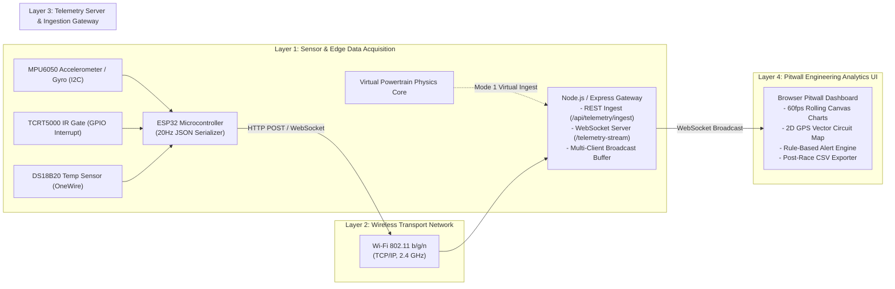

# IoT Architecture & Wireless Telemetry Pipeline

## 1. System Architecture Overview

In contemporary motorsport (Formula 1, WEC, Formula E), cars are mobile high-density IoT sensor networks generating upwards of 3 GB of telemetry data per Grand Prix.

This project implements an end-to-end telemetry pipeline demonstrating the complete path from physical or virtual sensor acquisition through wireless transmission, ingestion, real-time analytics, and engineering decision support:



---

## 2. Telemetry Ingest Modes

### Mode 1: Virtual Simulation Mode (Self-Contained)
- Vehicle kinematic equations and thermal models run directly inside the browser's JavaScript execution thread.
- TelemetryEngine samples physical parameters at a synchronous **20 Hz** rate (every 50 ms).
- Packets are passed to the Dashboard UI, plotted on Canvas graphs, evaluated by the Rule Engine, and forwarded via WebSocket to the server for distribution to secondary devices (e.g., tablet pitwall displays).

### Mode 2: Hardware IoT Mode (Physical ESP32 Prototype)
- An ESP32 microcontroller with an MPU6050 6-axis IMU, TCRT5000 optical gate, and DS18B20 temperature sensor measures real physical dynamics.
- Connects over local Wi-Fi to the laptop's Node.js server.
- The dashboard seamlessly visualizes incoming hardware measurements while maintaining clear sensor classification tags:
  - `[PHYSICAL SENSOR]` for actual hardware inputs.
  - `[DERIVED METRIC]` for calculated quantities (velocity integrals, lap timers).
  - `[SIMULATION ONLY]` for parameters not supported on the physical breadboard.

---

## 3. Network Bandwidth & Latency Analysis

| Parameter | Theoretical / Measured Value | Formula 1 Equivalent Standard |
|---|---|---|
| **Sampling Frequency** | $20 \text{ Hz}$ ($50 \text{ ms}$ interval) | $10 - 200 \text{ Hz}$ depending on channel |
| **Payload Size** | $\approx 280 \text{ bytes / packet}$ (JSON) | ATLAS binary compact frame ($\approx 120 \text{ bytes}$) |
| **Data Throughput** | $20 \times 280 \approx 5.6 \text{ KB/s}$ ($44.8 \text{ kbps}$) | $2.4 - 5.0 \text{ Mbps}$ telemetry burst |
| **Wi-Fi Transport Latency** | $4 - 12 \text{ ms}$ (Local AP) | $15 - 35 \text{ ms}$ (ATLAS cellular/trackside radio) |
| **Render Latency** | $\approx 16 \text{ ms}$ ($60 \text{ fps}$ RAF) | $< 50 \text{ ms}$ pitwall display latency |

---

## 4. REST Ingestion API Specification

### Endpoint: `POST /api/telemetry/ingest`
- **Content-Type**: `application/json`
- **Request Body**:
```json
{
  "source": "esp32_prototype_devkit_v1",
  "timestamp_ms": 1729014520100,
  "lap": 1,
  "lap_time_s": 14.85,
  "speed_kmh": 318.4,
  "accel_x_g": 0.04,
  "accel_y_g": 0.42,
  "accel_z_g": 0.98,
  "gyro_z_dps": 1.2,
  "temperature_c": 36.8,
  "ir_trigger": false,
  "battery_v": 3.82,
  "rssi_dbm": -56,
  "sensor_status": "ONLINE"
}
```
- **Response**: `200 OK`
```json
{ "status": "ACK", "timestamp": 1729014520112 }
```
