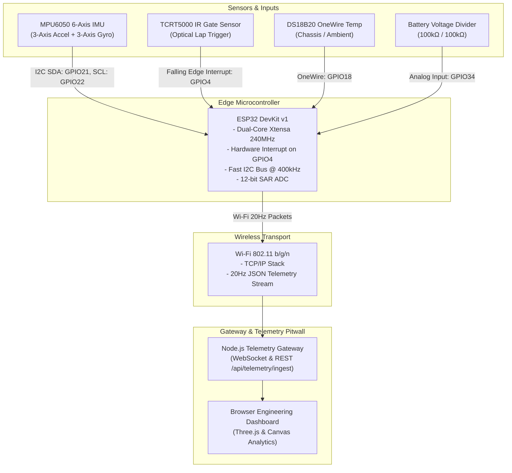

# ESP32 Telemetry Hardware Architecture & Wiring Schematic

## 1. Hardware Architecture Overview

This hardware subsystem implements a wireless IoT telematics unit suitable for small-scale prototype vehicles, RC racing testbenches, or karting demonstrators.



---

## 2. Pinout Connection Table

| ESP32 Pin | Component | Pin on Component | Description | Signal Type | Notes |
|---|---|---|---|---|---|
| **3V3** | All Sensors | VCC / 3.3V | Regulated 3.3V Power Rail | Power | Max 250mA draw across sensors |
| **GND** | All Sensors | GND | Common Circuit Ground | Power | Common ground reference |
| **GPIO 21** | MPU6050 IMU | SDA | I2C Serial Data | Bidirectional I2C | Internal pullup enabled (or external 4.7kΩ) |
| **GPIO 22** | MPU6050 IMU | SCL | I2C Serial Clock | Output Clock | 400 kHz Fast-Mode I2C |
| **GPIO 4** | TCRT5000 IR Gate | OUT / D0 | Optical Lap Trigger | Digital Input | Configured as `INPUT_PULLUP`, triggers interrupt |
| **GPIO 18** | DS18B20 Temp | DATA | OneWire Digital Bus | Bidirectional | Requires **4.7kΩ pull-up resistor** to 3V3 |
| **GPIO 34** | Battery Monitor | Voltage Node | 0 - 3.3V ADC Range | Analog Input | Voltage divider between R1(100k) & R2(100k) |
| **GPIO 2** | Onboard LED | Anode | Status Indicator | Output | Pulses upon packet transmission acknowledgment |

---

## 3. Circuit Schematic Diagram

```
                 +-----------------------------------+
                 |           ESP32 DevKit v1         |
                 |                                   |
    [3.3V] ------+ 3V3                           GND +------- [GND]
                 |                                   |
    [SDA]  ------+ GPIO 21 (I2C SDA)                 |
    [SCL]  ------+ GPIO 22 (I2C SCL)                 |
    [IR]   ------+ GPIO 4  (Interrupt)               |
    [TEMP] ------+ GPIO 18 (OneWire)                 |
    [BATT] ------+ GPIO 34 (ADC Input)               |
                 +-----------------------------------+

    MPU6050 6-DOF IMU:
    ------------------
    VCC  -----> 3.3V
    GND  -----> GND
    SDA  -----> GPIO 21  (with 4.7kΩ pullup to 3.3V)
    SCL  -----> GPIO 22  (with 4.7kΩ pullup to 3.3V)
    AD0  -----> GND      (Sets I2C address to 0x68)

    TCRT5000 IR Lap Gate:
    ---------------------
    VCC  -----> 3.3V
    GND  -----> GND
    OUT  -----> GPIO 4   (Detects retro-reflective strip on track finish line)

    DS18B20 Temperature Sensor:
    ---------------------------
    VDD  -----> 3.3V
    GND  -----> GND
    DATA -----> GPIO 18  (Requires 4.7kΩ pullup resistor between DATA and 3.3V)

    Battery Voltage Divider:
    ------------------------
    Battery (+) ----[ 100 kΩ ]----+----[ 100 kΩ ]----> Battery (-) / GND
                                  |
                                  v
                               GPIO 34
```

---

## 4. Hardware Mode vs Simulation Mode Verification

The system enforces a strict distinction between physical and simulated data:

1. **[PHYSICAL SENSOR]**:
   - `accel_x_g`, `accel_y_g`, `accel_z_g` (Measured by MPU6050 MEMS accelerometer)
   - `gyro_z_dps` (Measured by MPU6050 Coriolis vibrating gyroscope)
   - `temperature_c` (Measured by physical DS18B20 or thermistor)
   - `ir_trigger` (Measured by TCRT5000 IR optical reflection)
   - `battery_v` (Measured by ADC divider)

2. **[DERIVED / FILTERED]**:
   - Integrated velocity $v = \int a_y \, dt$
   - Instantaneous lap split $t_{lap} = t_{trigger} - t_{previous}$
   - Vector G-force magnitude $G_{total} = \sqrt{a_x^2 + a_y^2}$

3. **[SIMULATION ONLY]**:
   - Formula 1 Downforce (Aerodynamic CFD model)
   - 4 Individual Pirelli Tire Compound temperatures & graining
   - ERS Hybrid battery State of Charge
   - 8-Speed seamless gearbox ratio
